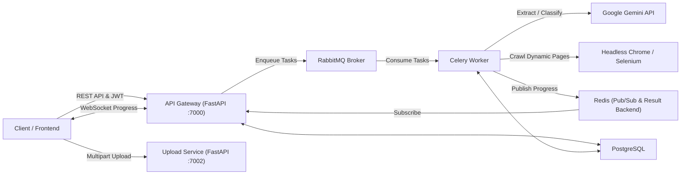

# Multi-Choice Extract Toolkit

A microservices-based backend toolkit for extracting structured multiple-choice, reading comprehension, and true/false questions and answers (Q&A) from **PDF documents**, **exam images**, and **web pages** using Multimodal LLMs (Google Gemini).

## Key Features

- **Multimodal Q&A Extraction**: Parses PDFs and images (automatically merging image sequences into PDFs) into strictly typed JSON schemas using Gemini Structured Outputs and Jinja2 prompt templates.
- **Question Classification & Metadata**: Supports `MULTIPLE_CHOICE`, `READING_COMPREHENSION` (with shared reference passages), and `TRUE_FALSE` (with sub-item splitting), tracking `page_number` and `position_in_page`.
- **Web Exam Crawler**: Crawls dynamic web pages with headless Selenium + BeautifulSoup to discover PDF/image URLs and filters out non-exam images via LLM classification.
- **Asynchronous Processing Pipeline**: Offloads heavy LLM extraction and crawling workloads to Celery workers backed by RabbitMQ (broker) and Redis (result backend).
- **Real-Time Progress Streaming**: Streams live task progress (`PREPROCESSING` -> `EXTRACTING` -> `POSTPROCESSING` -> `COMPLETED`) from Celery workers to clients via Redis Pub/Sub and FastAPI WebSockets.
- **Collection & File Management**: Organize files into collections, reorder pages, trigger single or batch extraction runs, and manage uploaded documents through a dedicated upload service.

## Architecture



## Tech Stack

- **Backend**: Python 3.13, FastAPI, Uvicorn, Pydantic v2, SQLAlchemy 2.0
- **AI / LLM**: Google GenAI SDK (`google-genai`), Jinja2 Prompt Management, PyMuPDF, Pillow
- **Async & Messaging**: Celery, RabbitMQ, Redis (Pub/Sub + Result Backend)
- **Web Scraping**: Selenium (Headless Chrome), BeautifulSoup4, lxml
- **Database & Infrastructure**: PostgreSQL 16, Docker, Docker Compose, `uv`

## Project Structure

```text
multi-choice-extract-toolkit/
├── api_gateway/          # FastAPI gateway (Auth, Collections, Files, Users, WebSocket progress)
├── celery_worker/        # Celery workers, Gemini LLM service, prompt templates, Selenium crawler
├── upload_document/      # Standalone FastAPI file validation & upload service
├── db/                   # Shared SQLAlchemy models, Pydantic schemas, and DB services
├── rabbitmq/             # RabbitMQ configuration
├── docker-compose.yml    # Full-stack Docker Compose setup
├── pyproject.toml        # Python dependencies managed with uv
├── .env.example          # Environment variable template
└── FRONTEND_SPEC_EN.md   # Frontend integration & API specification
```

## Quick Start

### Option 1: Docker Compose (Recommended)

1. Clone the repository and create your environment file:

```bash
git clone https://github.com/hoho303/multi-choice-extract-toolkit.git
cd multi-choice-extract-toolkit
cp .env.example .env
```

2. Set your `GEMINI_API_KEY` inside `.env`.

3. Start all services (PostgreSQL, Redis, RabbitMQ, API Gateway, Celery Worker, Upload Service):

```bash
docker compose up --build
```

4. Access the services:
   - **API Gateway Swagger UI**: `http://localhost:7000/docs`
   - **Upload Service Swagger UI**: `http://localhost:7002/docs`
   - **RabbitMQ Management UI**: `http://localhost:15672`

### Option 2: Local Development with `uv`

Make sure PostgreSQL, Redis, and RabbitMQ are running locally (or start only infra with `docker compose up -d postgres redis rabbitmq`), then:

```bash
# Install dependencies
uv sync

# Terminal 1 - API Gateway
PYTHONPATH=. uv run --directory api_gateway python main.py

# Terminal 2 - Upload Service
PYTHONPATH=. uv run --directory upload_document python main.py

# Terminal 3 - Celery Worker
PYTHONPATH=. uv run --directory celery_worker celery -A app.celery_app:celery worker --loglevel=INFO --concurrency=4
```

## API Overview

### Auth (`/api/auth`)
- `POST /api/auth/register` — Register a new user
- `POST /api/auth/login` — Authenticate and receive JWT `access_token` & `refresh_token`
- `POST /api/auth/refresh` — Refresh JWT tokens
- `POST /api/auth/verify-token` — Verify an access token

### Collections (`/api/collection`)
- `POST /api/collection/create` — Create a new exam collection
- `GET /api/collection/get-all` — List collections for the authenticated user
- `GET /api/collection/get/{collection_id}` — Get collection details
- `PUT /api/collection/update-file-orders/{collection_id}` — Reorder files within a collection
- `POST /api/collection/execute/{collection_id}` — Trigger Q&A extraction task
- `POST /api/collection/execute-batch` — Trigger batch extraction across multiple collections
- `GET /api/collection/import-files-from-web/{collection_id}?url=<url>` — Crawl and import exam files from a web page
- `GET /api/collection/get-qa/{collection_id}` — Fetch extracted questions and answers
- `GET /api/collection/get-result/{task_id}` — Poll Celery task status/result
- `DELETE /api/collection/delete/{collection_id}` — Soft-delete a collection
- `WS /api/collection/ws/progress/{session_id}/{collection_id}` — Stream real-time progress events

### Files & Upload
- `POST /api/file/create`, `GET /api/file/get-all/{collection_id}`, `DELETE /api/file/delete/{file_id}` (`api_gateway`)
- `POST /api/file/upload/single`, `POST /api/file/upload/multiple` (`upload_document`)

## Example Extracted Output

```json
{
  "code": "1",
  "type": "MULTIPLE_CHOICE",
  "content": "Which protocol is used by RabbitMQ as its primary messaging protocol?",
  "reference": "",
  "options": {
    "A": "FTP",
    "B": "AMQP",
    "C": "SMTP",
    "D": "SSH"
  },
  "correct_answer": "B",
  "page_number": 1,
  "position_in_page": 1
}
```

## License

This project is intended for personal portfolio and educational use.
